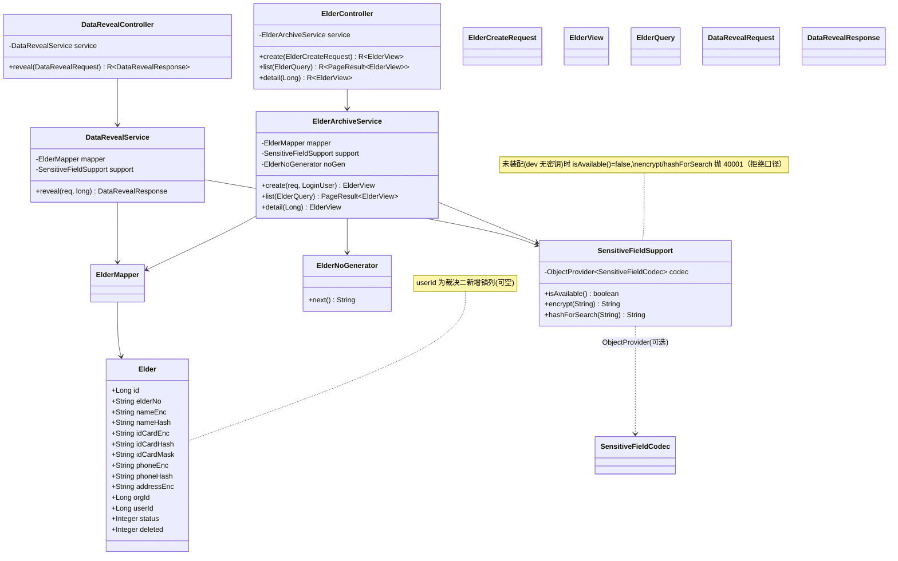
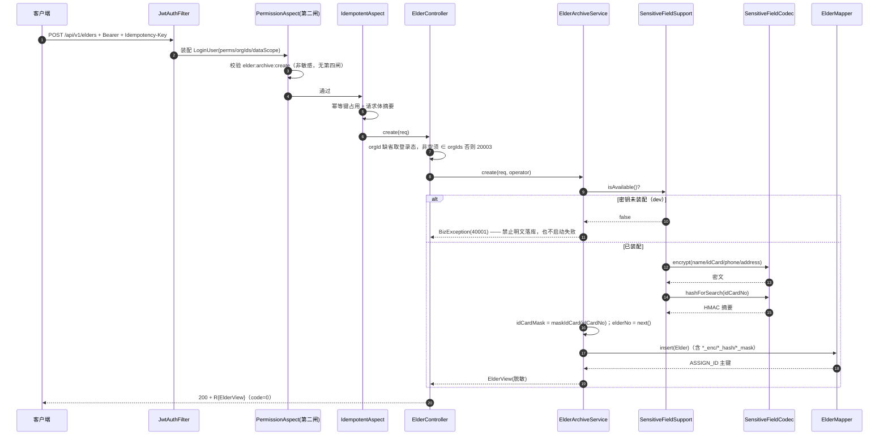
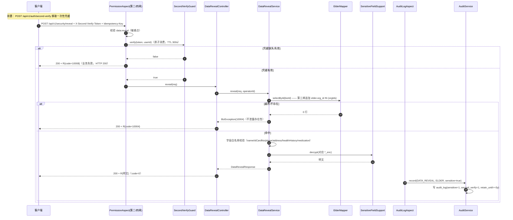
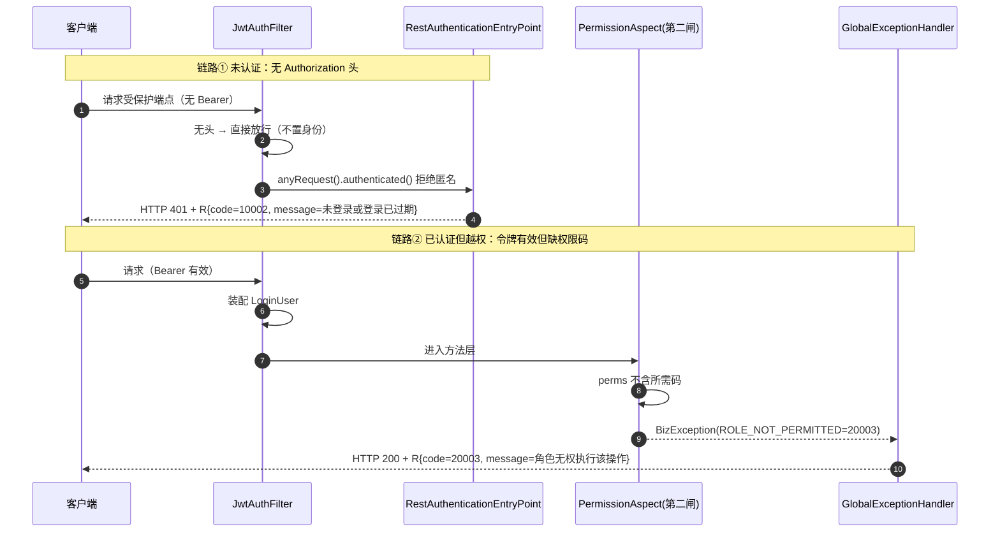

# D-2 档案域后端 · 增量设计 + 任务分解

> 角色：架构师（高见远）｜产出类型：**设计 + 裁决 + 任务分解**（不含业务代码）
> 范围：`yl-server` 档案域 4 个 planned 端点翻旗 + 1 处跨域安全修复（CR-M2-007）
> 真源：`openapi/yl-api.yaml` v1.1.1 ｜ `docker/mysql/init/0*.sql` ｜ `yl-api`/`yl-module-account` 既有四闸基建
> 阅读顺序：§1 裁决（可独立抄入 CR 卡）→ §2 实现方案 → §4 端点契约表 → §7 门禁影响 → §8 任务列表

---

## 0. 事实核对（本设计采信的现状，均已读源码确认）

| 事实 | 位置 | 对本设计的影响 |
|---|---|---|
| `yl-module-archive` 仅 `pom.xml`（依赖 `yl-api`），`src/` 下 0 个 java 文件 | `yl-modules/yl-module-archive/` | 全新代码，无历史包袱 |
| `@MapperScan("cn.yl.**.mapper")` + `scanBasePackages="cn.yl"` | `yl-bootstrap/.../YlApplication.java` | 新模块的 `mapper`/`@Component` **自动被发现**，无需改聚合/扫描 |
| `yl-api` 传递依赖 `yl-common`（`R` / `ErrorCode` / `SensitiveFieldCodec` / `MaskUtils` / `Idempotent` / `Audit` 均在 `yl-common`/`yl-api`） | pom 链 | 档案域**可编译期**引用上述类，**不可**引用 `cn.yl.modules.account.*` |
| `SensitiveFieldCodec` 由 `account/config/SensitiveFieldConfig` **条件装配**（双密钥非空才注册） | `SensitiveFieldConfig.java` | 档案域须以 `ObjectProvider` **可选注入**，处理"未装配"分支 |
| `Audit`（注解，`yl-api`）与 `AuditLogAspect`（`account`，`@Component`）分离 | `Audit.java` / `AuditLogAspect.java` / `AuditService.java` | 档案域可 `@Audit(...)` 而**不需**依赖 account 模块（切面运行时生效） |
| 业务失败一律 **HTTP 200 + `R.code`**；仅参数校验→400、未预期异常→500 | `GlobalExceptionHandler.handleBiz`（无 `@ResponseStatus`） | 所有"被拒"断言下沉到 `R.code` |
| `SecurityConfig.filterChain` **无** `exceptionHandling` → 未带凭据落默认 `Http403ForbiddenEntryPoint` | `SecurityConfig.java` L54-80 | 裁决一待处理 |
| `elder` 表**无任何指向登录账号的列**；`elder` 现列于 `SELF_DENY_TABLES` | `02_schema.sql` L185-214 / `DataScopePermissionHandler` L109-120 | 裁决二待处理 |
| `OpenApiContractTest` / `ControllerAuthorizationCoverageTest` 的控制器清单是**硬编码 list** | 两个测试 `CONTROLLERS` 常量 | 新增控制器**必须显式登记**，否则漂移断言红 |
| `data:reveal` ∈ `SensitivePermissions`（敏感点） | `SensitivePermissions.java` | reveal 端点**自动**联动第四闸，无需自写二次验证 |
| 门禁脚本 `verify-schema.sh` `EXPECTED_TOTAL_ASSERTIONS=81`；保留字金丝雀断言 = `1` | `scripts/verify-schema.sh` L263/L475 | 新增列须过金丝雀；新增断言须同步计数 |
| 金丝雀证明：库内**已存在多张 `user_id` 列**（`login_log`/`sys_user_role`/`idempotent_record`/`track_event`/`sys_user_third_party`），而金丝雀恒为 `1` | `02_schema.sql` + L263 断言 | ⇒ `user_id` **非 MySQL 保留字**，新增 `elder.user_id` **不触发金丝雀**（见 §6 不撞车证明） |

---

## 1. 两个裁决（可直接抄入 CR 卡作为"裁决记录"）

### 裁决一：CR-M2-007 —— 未认证统一为 `401 + R(10002)`（**采纳**）

**结论**：在 `SecurityConfig.filterChain` 补 `exceptionHandling`：

```java
.exceptionHandling(
    ex -> ex.authenticationEntryPoint(authenticationEntryPoint)   // 未认证 → 401 + R.fail(UNAUTHORIZED/10002)
             .accessDeniedHandler(accessDeniedHandler))            // 框架层拒绝 → 403 + R.fail(FORBIDDEN/10003)
```

| 项 | 裁定 |
|---|---|
| 状态码口径 | 未携带凭据 **401**（原本 403）；凭据无效/过期 **401**（保持）；已认证但被框架层拒绝 **403** |
| 响应体 | 一律统一 `R`（与 MVC 同一 `ObjectMapper` 序列化口径），`code` 分别 `10002`/`10003` |
| 实现位置 | 新增 `yl-api` 两个类：`cn.yl.api.security.RestAuthenticationEntryPoint`、`cn.yl.api.security.RestAccessDeniedHandler`（`@Component`，构造器注入 `ObjectMapper`）；`SecurityConfig` 构造器注入二者 |

**理由**
1. **一处修复，把类注释的承诺变成事实**：`SecurityConfig` 类注释已承诺"未认证统一返回 401 + 统一响应体"，现状（403 + 无体）是"实现与自身文档矛盾"。
2. **爆炸半径为零**：四端**尚无任何消费代码**；全仓**无**"无令牌 → 403"断言（已逐脚本/逐测试检索确认：`scripts/*.sh` 无 403 断言；`*.java` 中 `403` 仅出现在注释与指标分值 `{403,4}` 中，非状态码断言）。
3. **与既有口径自洽**：业务失败 = `200 + R.code`，仅**传输层/框架层**才改 HTTP 状态码；入口点/拒绝处理器正属框架层，落 `401/403 + R` 不破坏"业务=200"铁律。
4. **契约已如实声明**：v1.1.1 已声明 `401`(=凭据无效/过期) / `403`(=未携带凭据)，故**无需改契约**，`verify-openapi.sh` / `OpenApiContractTest` 不因本次变更而红。

**被否决方案**
- **保留 403-only（不动）** —— 否决。理由：与类注释承诺直接矛盾；客户端会把"未登录"误判为"已登录但无权限"，引导用户走错误路径（找管理员要权限，实际只需重登）；且 403 响应体非 `R`，使按 `code` 聚合的可观测性管道漏采这类事件。
- **改为全局 401（连"已认证但无权"也 401）** —— 否决。理由：混淆"认证失败"与"授权失败"两类语义，客户端无法区分"重登"与"无权限"；且与第四闸/第二闸的 `200 + 20003/10008` 口径割裂。

**与现有 `PermissionAspect` 的职责边界（务必写清，避免口径混战）**

| 拒绝来源 | 触发层 | 归属 | HTTP | `R.code` |
|---|---|---|---|---|
| 未认证（无/坏令牌） | Spring Security 过滤器链（**不入 DispatcherServlet**） | 第一闸 | **401** | `10002` |
| **框架层**已认证但被拒绝（`authorizeHttpRequests`/表达式） | Spring Security 授权管理器 | 第一闸 | **403** | `10003` |
| **业务层**无权（`@RequiresPermission` 不满足） | `PermissionAspect` → `BizException(ROLE_NOT_PERMITTED)` | 第二闸 | **200** | `20003` |
| 敏感操作缺二次验证 | `PermissionAspect` → `BizException(SECOND_VERIFY_REQUIRED)` | 第四闸 | **200** | `10008` |
| 数据域越界（行级不可见） | 第三闸 SQL 改写（查不到行） | 第三闸 | **200** | 业务码（如 `10004`） |

> **分工声明**：`ExceptionTranslationFilter`（入口点/拒绝处理器）**只处理过滤器链内**的 `AuthenticationException`/`AccessDeniedException`；`PermissionAspect` 抛的 `BizException` 发生在 DispatcherServlet 内，**只**由 `GlobalExceptionHandler` 收敛为 `200 + code`。**两条路径不重叠**——本项目所有业务端点经 `anyRequest().authenticated()` 后即进入方法层，框架层拒绝实际上仅在 `hasAuthority` 表达式被使用时才触发（本项目未使用）。故 `RestAccessDeniedHandler` 是"未来表达式授权"的兜底能力位，当前不承担业务越权判定。

**不改动的既有行为（回归保护）**：`/auth/login/**`、`/auth/refresh`、`/reports/verify`、`/system/health`、`/system/info`、`/actuator/**`、`/doc.html`、`/webjars/**`、`/v3/api-docs/**`、`/swagger-ui/**`、`/favicon.ico`、`OPTIONS /**` 仍 `permitAll`；`JwtAuthFilter` 对会话入口端点的跳过逻辑不变。

**验收（CR-M2-007 §六）**
- 无 `Authorization` → `401 + code=10002`（不再 403）；
- 坏/过期令牌 → `401 + code=10002`（保持）；
- 已认证无权码 → `200 + code=20003`（第二闸，保持）；
- 响应体与 MVC 同口径（同一 `ObjectMapper`）；
- 冒烟脚本新增「未携带凭据 → `401 + 10002`」断言（见 §7）。

---

### 裁决二：`scope=1`（本人）对档案域表的显式语义 —— **采纳方案 A（新增锚列 `elder.user_id`）**

**结论**：新增 `elder.user_id BIGINT NULL`（+ 可空唯一键 `uk_elder_user`），并把 `elder` 由 `SELF_DENY_TABLES` **移入** `SELF_COLUMN`（`elder → user_id`）。走本项目既有 DDL 补丁流程（提案文件 → 内联 `02_schema.sql` → `verify-schema.sh` 加断言）。

**理由**
1. **契约已声明 `by-role: {ELDER: self}` 且 `elder:archive:read` 已授予 ELDER**（`sys_role_permission` 权威事实 id 3027）。若保留失败即拒，则该角色**持有权限却永远读不到自己的档案**——"权限已授、语义不可达"是**静默失效**，比"未登记即放行"更难发现。
2. **与 D-1 裁决 2 同构**：家属端曾是"scope=1 无本人列 → 恒假 → 接口全空"，D-1 用新增 `DataScope.FAMILY(5)` 解决。老人端无任何既有关系表可锚（`elder_family_bind` 锚的是 `family_user_id`，`elder_authorization` 锚的是 `grantee_user_id`，均**非**老人本人的账号），故**必须新增锚列**，无可复用关系。
3. **消灭"结构上永不可达"的暗区**：登记为 `elder → user_id` 后，语义**结构上可实现**、由单测钉死 SQL 片段，后续 bonding 流程落地时**零额外数据域改动**。
4. **金丝雀安全**：`user_id` 非 MySQL 保留字（§6 证明），新增不触及金丝雀断言。

**Scope=1 下档案域四表落点（显式登记，无暗区）**

| 表 | scope=1（ELDER）落点 | 位置 | 说明 |
|---|---|---|---|
| `elder` | **`elder.user_id = <我>`** | `SELF_COLUMN`（**新增登记**） | 方案 A 新增锚列 |
| `elder_family_bind` | **失败即拒（`1=0`）** | `SELF_DENY_TABLES`（保留） | 无"本人"列；D-2 无读取该表端点 |
| `elder_authorization` | **失败即拒（`1=0`）** | `SELF_DENY_TABLES`（保留） | 无"本人"列；D-2 无读取该表端点 |
| `consent_record` | **失败即拒（`1=0`）** | `SELF_DENY_TABLES`（保留） | 锚为 `subject_type + subject_id`（**非** `elder_id`），已知缺口；本期家属端/老人端均无读取需求（沿用 D-1 残留登记） |

> `consent_record` 的已知缺口（锚非 `elder_id`）**本期不处理**：D-2 的 4 个端点均不查询该表；保持 `SELF_DENY_TABLES` 的失败即拒是**明确的保守落点**（非"未登记即放行"）。登记为 CR-M2-002 §八残留，继续有效。

**本期"谁来写 `user_id`"** —— **本期只加列 + 登记 + 单测钉死，不实现绑定写入流程**（老人↔登录账号的绑定属独立卡，登记为 D-2 残留 `D-2R1`）。因此：
- ELDER 端的 **E2E**（真机看到自己的档案）**依赖 `D-2R1`**，本期以**单元测试**钉住数据域 SQL 语义（`elder.user_id = N`），这是确定性的正确性证明；
- **不新增 dev 种子**：在无生产写入方的情况下加 dev 种子会"演示一条没有生产入口的路径"，具误导性；`D-2R1` 落地时一并补齐种子与 E2E。

**被否决方案**
- **方案 B（零 DDL，语义写死"无锚列一律失败即拒"并把契约 `by-role.ELDER` 改注为不可达）** —— 否决。理由：① 它把"权限已授予却永久不可达"固化下来，与 CR-M2-001「角色可见范围由数据域控制」的设计意图冲突；② 需改契约 `by-role` 注释，制造"契约描述 ≠ 权限授权"的可见矛盾；③ 未来 binding 落地时仍要回头加列并改登记，**把风险后移而非消除**。

---

## 2. 实现方案

### 2.1 `yl-module-archive` 完整文件列表

包根：`cn.yl.modules.archive`（与 `cn.yl.modules.evaluation` 同构分层：`controller/ service/ mapper/ dto/ domain/entity/ support/`）

**新增（14 个 java）**

| # | 相对路径 | 职责 |
|---|---|---|
| 1 | `yl-modules/yl-module-archive/src/main/java/cn/yl/modules/archive/controller/ElderController.java` | 建档 / 列表 / 详情 3 端点 |
| 2 | `yl-modules/yl-module-archive/src/main/java/cn/yl/modules/archive/controller/DataRevealController.java` | 敏感字段明文 1 端点 |
| 3 | `yl-modules/yl-module-archive/src/main/java/cn/yl/modules/archive/service/ElderArchiveService.java` | 建档（加密+摘要+脱敏）、列表、详情的领域逻辑 |
| 4 | `yl-modules/yl-module-archive/src/main/java/cn/yl/modules/archive/service/DataRevealService.java` | 敏感字段解密 + 字段白名单 + 越界即拒 |
| 5 | `yl-modules/yl-module-archive/src/main/java/cn/yl/modules/archive/service/ElderNoGenerator.java` | 生成对外档案号 `elder_no`（无隐私、可读、≤32） |
| 6 | `yl-modules/yl-module-archive/src/main/java/cn/yl/modules/archive/support/SensitiveFieldSupport.java` | 包装 `ObjectProvider<SensitiveFieldCodec>`：`isAvailable()/encrypt()/hashForSearch()`；未装配即"拒绝口径" |
| 7 | `yl-modules/yl-module-archive/src/main/java/cn/yl/modules/archive/domain/entity/Elder.java` | `elder` 表实体（含新列 `userId`） |
| 8 | `yl-modules/yl-module-archive/src/main/java/cn/yl/modules/archive/mapper/ElderMapper.java` | `BaseMapper<Elder>` |
| 9 | `yl-modules/yl-module-archive/src/main/java/cn/yl/modules/archive/dto/ElderCreateRequest.java` | 建档入参 |
| 10 | `yl-modules/yl-module-archive/src/main/java/cn/yl/modules/archive/dto/ElderView.java` | 脱敏视图（出参） |
| 11 | `yl-modules/yl-module-archive/src/main/java/cn/yl/modules/archive/dto/ElderQuery.java` | 列表筛选入参 |
| 12 | `yl-modules/yl-module-archive/src/main/java/cn/yl/modules/archive/dto/DataRevealRequest.java` | reveal 入参 |
| 13 | `yl-modules/yl-module-archive/src/main/java/cn/yl/modules/archive/dto/DataRevealResponse.java` | reveal 出参（字段→明文映射） |
| 14 | `yl-modules/yl-module-archive/src/test/java/cn/yl/modules/archive/service/ElderArchiveServiceTest.java` + `.../controller/ElderControllerTest.java` + `.../service/DataRevealServiceTest.java` | 单测（≥3 个测试类） |

**修改（既有文件）**

| # | 相对路径 | 改动 |
|---|---|---|
| 15 | `yl-modules/yl-module-account/src/main/java/cn/yl/modules/account/security/DataScopePermissionHandler.java` | `SELF_DENY_TABLES` 移除 `"elder"`；`SELF_COLUMN` 增 `Map.entry("elder","user_id")`；更新类 Javadoc |
| 16 | `yl-api/src/main/java/cn/yl/api/config/SecurityConfig.java` | 补 `exceptionHandling(...)`；构造器注入两个新 Bean；更新 `@SuppressFBWarnings` justification |
| 17 | `yl-api/src/main/java/cn/yl/api/security/RestAuthenticationEntryPoint.java`（**新增**） | 401 + `R.fail(UNAUTHORIZED)` |
| 18 | `yl-api/src/main/java/cn/yl/api/security/RestAccessDeniedHandler.java`（**新增**） | 403 + `R.fail(FORBIDDEN)` |
| 19 | `openapi/yl-api.yaml` | 4 个操作 `x-status: planned → implemented`（**仅此 4 个**） |
| 20 | `docker/mysql/init/02_schema.sql` | `elder` 增列 `user_id` + `uk_elder_user`（内联基线） |
| 21 | `scripts/verify-schema.sh` | 新增 1 条断言（`elder.user_id`）；`EXPECTED_TOTAL_ASSERTIONS 81 → 82` |
| 22 | `yl-bootstrap/src/test/java/cn/yl/bootstrap/contract/OpenApiContractTest.java` | `CONTROLLERS` 登记 2 个新控制器 |
| 23 | `yl-bootstrap/src/test/java/cn/yl/bootstrap/security/ControllerAuthorizationCoverageTest.java` | `CONTROLLERS` 登记 2 个新控制器 |
| 24 | `yl-modules/yl-module-account/src/test/java/cn/yl/modules/account/security/DataScopePermissionHandlerTest.java` | 新增 scope=1 `elder` 用例（钉 `(elder.user_id = N)`） |
| 25 | `scripts/smoke-report-review-chain.sh` | 新增「档案域」段 + 「未携带凭据 → 401+10002」断言 |
| 26 | `docs/reviews/D2-archive-DDL-Patch-Proposal.sql`（**新增**） | 变更留痕（提案文件） |
| 27 | `docs/change/CR-M2-007-*.md` | 补"裁决记录"段（采纳） |

### 2.2 关键类职责与方法签名

**`ElderController`**（`@RequestMapping("/api/v1/elders")`）

```java
@PostMapping
@RequiresPermission(PermissionCode.ELDER_ARCHIVE_CREATE)
@Idempotent(verifyBody = true)
public R<ElderView> create(@Valid @RequestBody ElderCreateRequest req);

@GetMapping
@RequiresPermission(PermissionCode.ELDER_ARCHIVE_READ)
public R<PageResult<ElderView>> list(ElderQuery query);

@GetMapping("/{elderId}")
@RequiresPermission(PermissionCode.ELDER_ARCHIVE_READ)
public R<ElderView> detail(@PathVariable Long elderId);
```
- 构造器注入 `ElderArchiveService`，带 `@SuppressFBWarnings("EI_EXPOSE_REP2")` + justification（沿用 `AssessmentController` 范式）。
- **身份一律取登录态**：`LoginUser user = SecurityUtils.requireUser();`，请求体**不承载** `createdBy` 等身份字段。

**`DataRevealController`**（`@RequestMapping("/api/v1/security")`）

```java
@PostMapping("/reveal")
@RequiresPermission(PermissionCode.DATA_REVEAL)          // 敏感点 → 自动联动第四闸
@Idempotent(verifyBody = true)
@Audit(action = "DATA_REVEAL", bizType = "ELDER", sensitive = true)  // 成功后写 audit_log(sensitive=1)
public R<DataRevealResponse> reveal(@Valid @RequestBody DataRevealRequest req);
```

**`ElderArchiveService`**

```java
@Transactional
ElderView create(ElderCreateRequest req, LoginUser operator);   // 归属机构域校验 + 加密 + 摘要 + 脱敏
PageResult<ElderView> list(ElderQuery query);                    // 分页 + keyword(hash 精确/elder_no 前缀)
ElderView detail(Long elderId);                                  // 查不到 → NOT_FOUND(10004)
```

**`SensitiveFieldSupport`**

```java
boolean isAvailable();                     // codec Bean 是否存在
String encrypt(String plain);              // 未装配 → throw BizException(ARCHIVE_SENSITIVE_ENCRYPT_FAILED)
String hashForSearch(String plain);        // 同上
String maskName/String maskIdCard/String maskPhone(...)   // 委托 yl-common MaskUtils
```

**`DataRevealService`**

```java
DataRevealResponse reveal(DataRevealRequest req, long operatorId);  // 白名单字段 → decrypt；表经第三闸 org 收口
```

---

## 3. 数据结构与接口

### 3.1 实体 `Elder`（对应 `elder`，**新增 `userId`**）

| 属性 | 列 | 类型 | 备注 |
|---|---|---|---|
| `id` | `id` | Long | `@TableId(type = IdType.ASSIGN_ID)`（ADR-0003，无 AUTO_INCREMENT） |
| `elderNo` | `elder_no` | String | 对外编号，唯一，**非隐私** |
| `nameEnc` / `nameHash` | `name_enc` / `name_hash` | String | 密文 / HMAC 摘要 |
| `idCardEnc` / `idCardHash` / `idCardMask` | 同名 | String | 密文 / 摘要 / 脱敏串 |
| `phoneEnc` / `phoneHash` | 同名 | String | 密文 / 摘要 |
| `addressEnc` | `address_enc` | String | 密文 |
| `healthHistoryEnc` / `medicationEnc` | 同名 | String | 密文（TEXT，D-2 不写） |
| `gender` / `birthDate` / `age` | 同名 | Integer / LocalDate / Integer | |
| `orgId` | `org_id` | Long | 归属机构 |
| **`userId`** | **`user_id`** | **Long** | **本人登录账号锚（裁决二新增，可空）** |
| `photoCosKey` / `status` / `deleted` | 同名 | String / Integer / Integer | |
| `createdBy` / `createdAt` / `updatedBy` / `updatedAt` | 同名 | | `created_at/updated_at` 依赖 DB 默认值（同 `EvalTask` 范式，实体不填充） |

> 实体**不映射**生成列（`elder` 无生成列，无需处理）；`deleted` 为普通列，**查询须显式 `deleted = 0`**（`DataScopePermissionHandler` 不改 `deleted` 条件）。

### 3.2 DTO 字段与校验

**`ElderCreateRequest`**（`src` 明文提交，服务端加密落库）

| 字段 | 校验 | 说明 |
|---|---|---|
| `name` | `@NotBlank`，`@Size(max=64)` | 明文提交 |
| `idCardNo` | `@Pattern(18位身份证)`，可空 | 明文提交；**禁止回显** |
| `gender` | `@Min(0) @Max(2)`，可空 | |
| `birthDate` | `@Past`，可空 | |
| `phone` | `@Pattern(手机号)`，可空 | |
| `address` | `@Size(max=256)`，可空 | |
| `orgId` | 可空（`null` → 取登录态默认机构；非空 → 须 ∈ `LoginUser.orgIds()`） | 见 §10 待明确 #1 |

**`ElderView`**（**全部脱敏**）

| 字段 | 来源 | 形态 |
|---|---|---|
| `id` / `elderNo` / `gender` / `age` / `orgId` / `status` | 明文列 | 原样 |
| `name` | `decrypt(name_enc)` → `MaskUtils.maskName` | `张*` |
| `idCardMask` | `id_card_mask` 列 | `5301**********1234` |
| `phone` | `decrypt(phone_enc)` → `MaskUtils.maskPhone` | `138****5678` |
| ~~`address`~~ | **不出现在列表/详情默认视图** | 仅 `.reveal` 可取 |

> 契约 `ElderView` 不含 `address`；`x-sensitive-fields: [name, idCardMask, phone, address]` 指"该资源含这些敏感字段"，**默认脱敏**。地址仅在 `dataReveal` 中明文返回。

**`DataRevealRequest`**：`bizType`(`@NotNull`, enum ELDER/USER)、`bizId`(`@NotNull`)、`fields`(`@NotEmpty List<String>`)。
**`DataRevealResponse`**：`bizType`、`bizId`、`fields: Map<String,String>`（字段名 → 明文）。

### 3.3 类图



---

## 4. 端点契约表

权限码来源：`docker/mysql/init/03_seed_rbac.sql` 的 `sys_role_permission`（**权威事实**）。

| # | Method / Path | operationId | 权限码（来源 id → 持有角色） | 数据域 mode | 二次验证 | 幂等 | 错误码（复用现有 `ErrorCode`） | 留痕 |
|---|---|---|---|---|---|---|---|---|
| 1 | `POST /api/v1/elders` | `elderCreate` | `elder:archive:create`（2017 → ASSESSOR, ORG_ADMIN） | `org` | 否 | **`Idempotency-Key` 必填**（`@Idempotent`） | `10001` 参数；`20003` 机构越域；`10005` 身份证重复；`40001` 密钥未装配 | 可选（建议后续） |
| 2 | `GET /api/v1/elders` | `elderList` | `elder:archive:read`（2019 → 五角色全授予） | `relation` | 否 | 否 | `10001` 分页参数 | `ArchiveAccessRateGuard` 自动监控（只告警） |
| 3 | `GET /api/v1/elders/{elderId}` | `elderDetail` | `elder:archive:read`（2019 → 五角色全授予） | `relation` | 否 | 否 | `10004` 越界/不存在（**同码，不泄露存在性**） | 同上 |
| 4 | `POST /api/v1/security/reveal` | `dataReveal` | `data:reveal`（2021 → **仅 ORG_ADMIN**） | `org` | **是**（`X-Second-Verify-Token`，自动） | **`Idempotency-Key` 必填** | `10008` 缺二次验证；`10004` 越界/不存在；`10001` 非法字段/bizType；`10002` 未登录 | **`audit_log(sensitive=1, second_verify=1)`**（`@Audit`） |

**数据域落点说明（四端点 × 五角色）**

| 端点 | ORG_ADMIN(2) / ASSESSOR(2) | ELDER(1) | FAMILY(5) | SUPERVISOR(4) |
|---|---|---|---|---|
| `elderCreate` | org 域内可建 | 无权限码（红线：ELDER 不持 `create`） | 无权限码（家属持 `create:apply`，非本端点） | 无权限码（红线） |
| `elderList` / `elderDetail` | `elder.org_id IN (orgIds)` | `elder.user_id = me`（**方案 A**） | `elder.id IN (我生效绑定)` | 不加限（只读全局） |
| `dataReveal` | `elder.org_id IN (orgIds)`（仅 ORG_ADMIN 持码） | 无权限码 | 无权限码 | 无权限码 |

**错误码复用声明（无新增）**：全部命中现有 `ErrorCode`（`10001/10004/10005/10008/20003/40001`），**不新增 4xxxx 号段**，故**无需**提供"不撞车证明"之外的新码登记。

**幂等**：`@Idempotent(verifyBody=true)`（`IdempotentAspect` 按 `Idempotency-Key` + 请求体摘要去重，缺失键 → `10007`）。

---

## 5. 时序图

### 5.1 建档链路（加密 + 摘要 + 脱敏）



### 5.2 reveal 链路（二次验证 + audit_log 留痕）



### 5.3 拒绝链路（未认证 / 越权 —— 标清 HTTP 与 `R.code`）



> **断言口径（务必遵守，见 §7）**：链路①看 **HTTP 状态码 401** + 体 `R.code=10002`；链路②看 **HTTP 200** + `R.code=20003`。**绝不以 HTTP 200 当"放行"证据**。

---

## 6. DDL 与种子影响清单（裁决二·方案 A）

### 6.1 `ALTER TABLE` 草案（→ 内联进 `02_schema.sql` 基线）

提案文件：`docs/reviews/D2-archive-DDL-Patch-Proposal.sql`

```sql
USE `yl_evaluation`;

-- D-2 裁决二·方案 A：ELDER(scope=1) 自见锚列。
-- 依据：契约 by-role:{ELDER: self} + elder:archive:read 已授予 ELDER（03_seed_rbac.sql id 3027）。
-- 语义：elder.user_id = sys_user.id（老人本人的登录账号）；可空，未绑定为 NULL。
-- 注意：user_id 非 MySQL 保留字（库内 login_log/sys_user_role/idempotent_record/track_event 等已有多列同名列，
--       保留字金丝雀恒为 1 即为证据），故不触发金丝雀断言。
ALTER TABLE `elder`
  ADD COLUMN `user_id` BIGINT NULL COMMENT '本人登录账号（sys_user.id，应用层引用；可空）' AFTER `org_id`,
  ADD UNIQUE KEY `uk_elder_user` (`user_id`);
-- 引用完整性：ADR-0003 全库 0 物理外键，仅逻辑引用（不建 FK）。
```

**内联方式**：按本项目惯例（见 `ER-20260918-DDL-Patch-Proposal.sql` 的"基线自带"口径），直接在 `02_schema.sql` 的 `elder` 建表语句内加入该列与唯一键，提案文件保留为变更留痕。

### 6.2 `verify-schema.sh` 新增断言（+1 条）

```sh
# 档案锚列 elder.user_id（D-2 裁决二·方案 A：ELDER 自见锚；契约 by-role.ELDER=self 落地依据）
check "档案自见锚列 elder.user_id（bigint，可空）" "$(sql "SELECT COUNT(*) FROM information_schema.columns WHERE table_schema='$DB_NAME' AND table_name='elder' AND column_name='user_id' AND data_type='bigint';")" "1"
```

- **`EXPECTED_TOTAL_ASSERTIONS` 81 → 82**（自检：断言被增删未同步即报警）。
- 头部注释补一行变更说明：`81 → 82：D-2 新增档案自见锚列 assert 1 条`。

### 6.3 是否触发保留字金丝雀？—— **否**（不撞车证明）

金丝雀断言（L263）为：
```sql
SELECT COUNT(*) FROM information_schema.columns c
JOIN information_schema.KEYWORDS k ON UPPER(c.column_name)=k.WORD AND k.RESERVED=1
WHERE c.table_schema='$DB_NAME';
```
当前恒为 `1`（唯一命中 `audit_log.sensitive`）。

**证明**：库内**已存在多列 `user_id`**（`login_log` / `sys_user_role` / `idempotent_record` / `track_event` / `sys_user_third_party`）。若 `USER_ID` 命中 `KEYWORDS(RESERVED=1)`，命中数早已 **> 1**，与实测 `= 1` 矛盾。故 `user_id` **非保留字**，新增 `elder.user_id` **不改变**命中数（仍 `= 1`）。

### 6.4 是否影响其它既有断言？—— **否**

| 断言 | 期望值 | 新增列的影响 |
|---|---|---|
| `deleted` 列数 | `21`（精确） | **无**（未新增/删除 `deleted`） |
| 生成列 `active_uk` 数 | `5` | **无**（`uk_elder_user` 是普通唯一键，非生成列） |
| 密文列 `*_enc` | `≥10` | **无** |
| DATETIME 列 | `≥60` | **无**（新列是 `BIGINT`） |
| 索引总数 | `≥40` | 新增 1 个唯一键 → 更宽松（仍通过） |
| 自增列 | `1`（仅 `gb_rule_version`） | **无**（`BIGINT` 非自增） |
| 外键数 | `0` | **无**（不建 FK） |
| 个人信息表明文敏感列 | `0` | **无**（`user_id` 不在断言列名清单内） |
| 关键表白名单 | 逐表存在 | **无**（未新增表） |

### 6.5 种子影响

- **`03_seed_rbac.sql`：零改动**（不新增权限码/授权）。
- **`04_seed_dev_accounts.sql`：零改动**（本期不新增 ELDER dev 账号与绑定，理由见 §1 裁决二）。

---

## 7. 对既有门禁与测试的影响清单

> ⚠️ **"翻旗后不同步测试会立刻变红"的位置已加粗标注。**

| # | 门禁 / 测试 | 是否受影响 | 必须同步的动作 |
|---|---|---|---|
| 1 | **`OpenApiContractTest.declaredImplementedOperationsMatchControllersExactly`**（`yl-bootstrap`） | **是（红）** | **翻旗 4 个操作 + 在 `CONTROLLERS` 登记 `ElderController`、`DataRevealController`，二者缺一即双向漂移失败**。注意 `CONTROLLERS` 是硬编码 list，**新控制器不登记则"代码有端点、契约未登"或反之直接红**。 |
| 2 | `OpenApiContractTest.everyOperationDeclaresPermissionAndDataScope` / `mode∈枚举` / `敏感点⟺x-second-verify` | 是（软） | 4 操作本身合规；`dataReveal` 已带 `x-second-verify: true`，翻旗不动扩展键，**预期不红** |
| 3 | **`scripts/verify-openapi.sh`［5/5］漂移（双向）** | **是（红）** | 与 #1 同源；契约 `implemented` 集合须 = 控制器端点集合。**翻旗但未建控制器 / 建了控制器未翻旗 / 未登记 → 红** |
| 4 | **`ControllerAuthorizationCoverageTest.everyHandlerEndpointDeclaresPermission`**（`yl-bootstrap`） | **是（红）** | **两个新控制器必须登记进 `CONTROLLERS`，且每个端点须挂 `@RequiresPermission`（4 端点全部要挂）**；白名单只 4 条，**不得**为档案端点新增白名单（且 `whitelistHasNoRedundantEntry` 会拦多余豁免） |
| 5 | **`scripts/verify-schema.sh` 断言总数自检** | **是（红）** | **新增 1 条断言后必须把 `EXPECTED_TOTAL_ASSERTIONS` 改 82**，否则自检失败；同时 `02_schema.sql` 内联列后需复跑全绿 |
| 6 | `scripts/verify-schema.sh` 保留字金丝雀（=1） | 否（软） | 不改期望值（§6.3 证明不撞车） |
| 7 | `DataScopePermissionHandlerTest` | 否/软 | 现有用例**未**触及 `elder` 在 scope=1 的分支，**不因移出 `SELF_DENY_TABLES` 而红**；**应新增**用例钉 `(elder.user_id = N)`（回归保护） |
| 8 | `JwtAuthFilterTest` | 否 | 未断言 HTTP 403/入口点，CR-M2-007 修复不触红 |
| 9 | `scripts/smoke-report-review-chain.sh`（当前 34 通过/0 失败/1 跳过，6 段） | 是（增量） | 新增「档案域」段 + 「未携带凭据 → `401 + 10002`」断言。注意脚本**无固定断言总数、勿硬编码**（见其头注释） |
| 10 | `mvn -o verify`（Checkstyle/Spotless/SpotBugs） | 是（软） | 遵守：禁 `System.out`/`java.util.Date`/星号导入/Tab/行尾空格；圈复杂度 ≤15；控制器注入 Service 用 `@RequiredArgsConstructor(onConstructor_=@SuppressFBWarnings("EI_EXPOSE_REP2"))` 且**带 justification**；新类的注入同理；跑 `mvn -o -q spotless:apply` 修格式 |
| 11 | `ReservedWordColumnMappingTest` | 否 | `user_id` 非保留字，实体无需反引号映射 |

---

## 8. 有序任务列表（供工程师直接执行）

> 硬约束：≤5 个任务；每任务 ≥3 文件；T01 为基础设施/数据层；避免长线性依赖链。
> 关键路径：**T01 →（T02 ∥ T03）→ T04 → T05**（T02/T03 可并行）。

### T01（P0）基础设施与数据层（DDL / 数据域登记 / 实体 / DTO / 支撑）
- **Source Files**：
  - `docs/reviews/D2-archive-DDL-Patch-Proposal.sql`（新增）
  - `docker/mysql/init/02_schema.sql`（`elder` 内联 `user_id` + `uk_elder_user`）
  - `yl-modules/yl-module-account/.../security/DataScopePermissionHandler.java`（`elder` 移出 `SELF_DENY_TABLES` → 入 `SELF_COLUMN`，更新 Javadoc）
  - `yl-modules/yl-module-archive/.../domain/entity/Elder.java`、`.../mapper/ElderMapper.java`
  - `yl-modules/yl-module-archive/.../support/SensitiveFieldSupport.java`
  - `.../dto/ElderCreateRequest.java`、`ElderView.java`、`ElderQuery.java`、`DataRevealRequest.java`、`DataRevealResponse.java`
- **Dependencies**：无
- **作为独立提交单元**：✅（"数据层骨架就绪"，门禁不翻旗，不红）
- **Priority**：P0

### T02（P0）建档与查询链路
- **Source Files**：`.../service/ElderNoGenerator.java`、`.../service/ElderArchiveService.java`、`.../controller/ElderController.java`、`.../test/.../ElderArchiveServiceTest.java`、`.../test/.../ElderControllerTest.java`
- **Dependencies**：T01
- **要点**：orgId 缺省/越域（`20003`）；加密未装配 → `40001`（禁明文落库）；`id_card_hash` 重复 → `10005`；`keyword` 用 `name_hash` 精确 + `elder_no` 前缀；读端点挂 `elder:archive:read`
- **Priority**：P0

### T03（P0）reveal 链路 + CR-M2-007 未认证修复
- **Source Files**：`.../service/DataRevealService.java`、`.../controller/DataRevealController.java`、`.../test/.../DataRevealServiceTest.java`、`yl-api/.../security/RestAuthenticationEntryPoint.java`（新）、`yl-api/.../security/RestAccessDeniedHandler.java`（新）、`yl-api/.../config/SecurityConfig.java`（补 `exceptionHandling`）
- **Dependencies**：T01
- **要点**：reveal 字段白名单；`@Audit(sensitive=true)` 留痕；二次验证由 `PermissionAspect` 自动联动；CR-M2-007 只动 `SecurityConfig` + 两个新类
- **Priority**：P0

### T04（P0）契约翻旗与门禁同步（**红点收敛**）
- **Source Files**：`openapi/yl-api.yaml`（4 操作 → `implemented`）、`yl-bootstrap/.../contract/OpenApiContractTest.java`（登记 2 控制器）、`yl-bootstrap/.../security/ControllerAuthorizationCoverageTest.java`（登记 2 控制器）、`scripts/verify-schema.sh`（+1 断言，`EXPECTED_TOTAL_ASSERTIONS→82`）、`yl-modules/yl-module-account/.../test/.../DataScopePermissionHandlerTest.java`（+scope=1 elder 用例）
- **Dependencies**：**T02、T03**（控制器须已存在，否则 #1/#3 漂移断言红）、T01（schema）
- **作为独立提交单元**：✅（"门禁全绿"里程碑）
- **Priority**：P0

### T05（P1）冒烟与端到端验证
- **Source Files**：`scripts/smoke-report-review-chain.sh`（新增档案域段 + 401 断言）、`docs/reviews/D2-e2e-checklist.md`（新增，验收清单）
- **Dependencies**：T04
- **要点**：真实 HTTP 冒烟——建档（需配 `SENSITIVE_FIELD_KEY`/`HASH_KEY`）→ 列表（第三闸按机构收口）→ 详情（脱敏）→ reveal（缺 `X-Second-Verify-Token` 得 `10008`，带令牌得明文且 `audit_log` 有行）→ 未认证得 `401 + 10002`；断言下沉到 `R.code`
- **Priority**：P1

---

## 9. 共享知识（跨文件约定）

1. **命名**：包根 `cn.yl.modules.archive`；分层 `controller/service/mapper/dto/domain/entity/support`（对齐 evaluation）。控制器 `XxxController`，服务 `XxxService`，实体无后缀，DTO 入参 `XxxRequest`/出参 `XxxView`/`XxxResponse`。
2. **身份来源**：一律 `SecurityUtils.requireUserId()`/`requireUser()` 取登录态；**请求体不得承载身份字段**（`createdBy` 等由服务端取登录态）。这是 CR-M2-002 的既定铁律。
3. **事务边界**：写操作（`create`）标 `@Transactional`（`org.springframework.transaction`）；读操作只读不加事务。单条 `insert` 亦标，保持范式一致并预留扩展。
4. **加密未装配的拒绝口径**：`SensitiveFieldSupport.isAvailable()==false`（dev 无密钥）时，**create/reveal 直接抛 `BizException(ARCHIVE_SENSITIVE_ENCRYPT_FAILED=40001)`**——**禁止明文落库，也不允许应用启动失败**（沿用 `SensitiveFieldConfig` "不配密钥≠起不来"的取舍）。
5. **日志脱敏**：禁止打印任何明文敏感值（身份证/姓名/手机/住址）；日志仅用 `elderNo`/`masked`/`count`；`audit_log.detail` 仅记脱敏上下文。
6. **错误码**：业务失败 = `HTTP 200 + R.code`；断言看 `R.code`。复用现有码，**不新增**。
7. **数据域**：读操作的机构/关系收口由 `DataScopePermissionHandler`（第三闸）**自动**完成，服务层**不要**再手写 `org_id` 过滤（避免双写不一致）；写操作的机构合法性由**服务/控制器显式校验**（同 `AssessmentController`）。
8. **时间列**：`DATETIME`，`created_at/updated_at` 依赖 DB 默认值（实体不填充，同 `EvalTask`）；软删除查询显式 `deleted=0`。
9. **主键**：`@TableId(type = IdType.ASSIGN_ID)`；手写 SQL 必须显式赋 `id`（表无 `AUTO_INCREMENT`）。
10. **门禁自检**：提交前 `mvn -o verify` + `bash scripts/verify-openapi.sh` + `bash scripts/verify-schema.sh` 全绿；格式用 `mvn -o -q spotless:apply`。

---

## 10. 待明确事项（按阻塞程度排序，≤5 条）

| # | 事项 | 阻塞度 | 建议处置 |
|---|---|---|---|
| 1 | **`ElderCreateRequest.orgId` 语义**：契约 `ElderCreate.required=[name, orgId]` 与操作描述"归属机构缺省取登录态默认机构"**矛盾** | **中（阻塞实现口径）** | 建议 **DTO 允许 `orgId` 可空**（`null`→登录态默认），与 `CreateAssessmentRequest` 一致；契约 `required` 本轮**不改**（服务端更宽松，客户端仍可传），登记为契约待订正项 |
| 2 | **`dataReveal.bizType=USER`**：契约 enum 含 `[ELDER, USER]`，但档案域无 `USER` 语义（属账号域） | 中 | 本期**仅实现 `ELDER`**；`bizType=USER` 返回 `10001`（"暂不支持"），登记残留；不加新权限码 |
| 3 | **`ELDER:self` E2E 依赖**：`elder↔user` 绑定写入流程（`D-2R1`）本期不实现 | 低 | 本期以 `DataScopePermissionHandlerTest` 单测钉死 `(elder.user_id = N)` 语义；E2E 随 `D-2R1` 补齐 |
| 4 | **`audit_log.biz_id` 未写入**：`@Audit`/`AuditService.record(action,bizType,sensitive,detail)` **无** `bizId` 参数 | 低 | 本期接受（`action=DATA_REVEAL, biz_type=ELDER, sensitive=1` 已足够留痕）；若需 `biz_id`，需扩 `account` 模块 `AuditService`（轻微扩面），登记为可选增强 |
| 5 | **`elder_no` 生成规则**：无既有规范 | 低 | 建议 `"ELD" + yyyyMMdd + 6 位随机/序号`（≤32）；唯一性靠 `uk_elder_no` + 冲突重试；实现方定稿后写入代码注释 |

---

## 附：图文件

- 时序图：`docs/design/D2-sequence-diagram.mermaid`
- 类图：`docs/design/D2-class-diagram.mermaid`

> 说明：按本仓 `docs/design/` 惯例以 `D2-` 前缀命名，避免与其它模块图文件冲突（通用路径 `docs/*.mermaid` 留作全局图使用）。
